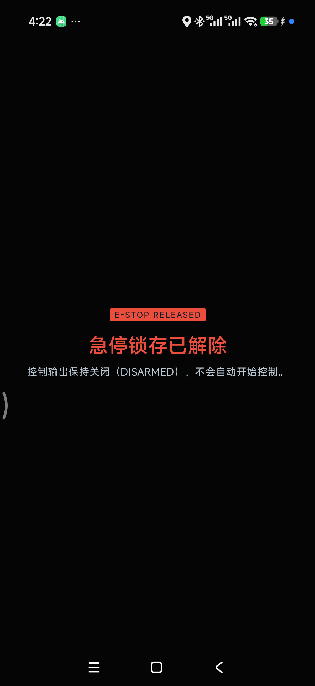
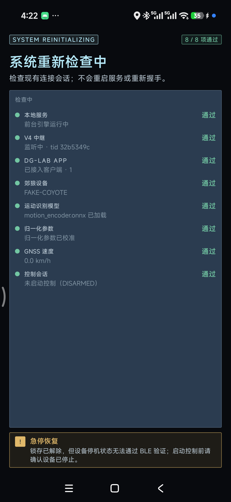
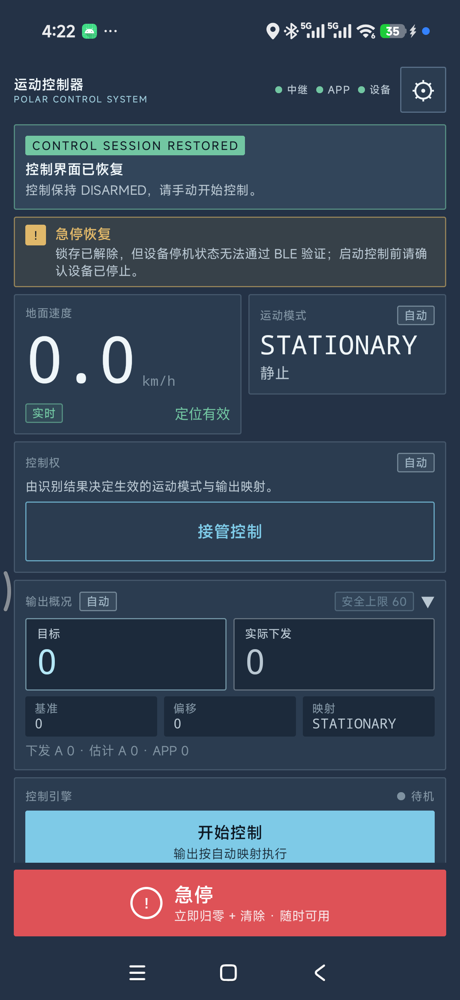
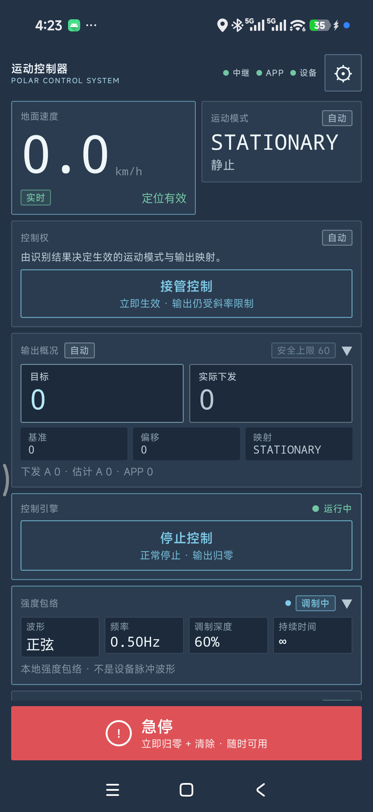

# MotionController — 智能运动识别与设备控制终端

> 手机本地运动控制链路：IMU/GNSS → ONNX 运动分类 → 状态映射为强度 → 本地 V4 WebSocket 中继 → DG-LAB APP → 郊狼主机。

**MotionController 是独立的智能运动识别与设备控制终端**：由手机自身传感器识别当前运动状态，按可配置的映射规则生成强度指令，经**本机** V4 WebSocket 中继发送给 DG-LAB APP，再由 APP 通过 BLE 驱动郊狼主机。

它与任何汽车品牌无关，**不是汽车品牌配套软件**，也不读取车辆总线、车机或车企云服务数据；全部识别与控制在手机本地完成，不上传传感器数据。

> ⚠️ 本项目涉及电刺激设备控制，属于个人实验性工程，不是医疗器械或安全设备。使用前请阅读 [已知限制](#已知限制) 与 [安全声明](#安全声明)。

---

## 主要功能

界面按「三状态页面 + 独立紧急模式」组织：`PRE-FLIGHT → OPERATION ↔ ENGINEERING`，急停锁存时由 `EMERGENCY` 全屏接管。

### PRE-FLIGHT（起飞前自检）

- 单机（`127.0.0.1`）/ 双机（`0.0.0.0` + 内网 IP）连接模式切换；
- 一键复制 V4 中继地址（`ws://<host>:9998/?tid=<targetId>`）或展示二维码，供 DG-LAB APP 连接；
- 7 项真实自检（服务、中继、模型、Scaler、GNSS、DG-LAB APP、设备；复位后另有非关键「急停恢复」项），按 `PASS / WAITING / FAIL / DISCONNECTED` 呈现；
- **导航门禁**：关键项未通过（尤其 DG-LAB APP 未连接）时禁止进入 OPERATION，并显示阻塞原因；
- 进入 OPERATION 前播放 ≤1.5s 启动动效（尊重系统「减少动态效果」）。

### OPERATION（运行控制）

- GNSS 速度仪表：`LIVE / STALE / UNAVAILABLE` 三态，从不把「无定位」伪造成 `0`；
- 实时运动识别结果（STATIONARY / WALKING / CYCLING / CAR / TRAIN）与稳定类别；
- **AUTO / MANUAL OVERRIDE**：可人工接管并切换类别基准；「归还自动」要求模型数据新鲜，否则禁用并说明原因；
- **强度映射**：`目标 = clamp(classBase[类别] + manualOffset, 0, safetyMax)`，叠加 slew 限制、EMA、换类防抖与 REST 静止矛盾消除；
- **本地强度包络（WavePanel）**：开关、形状（FLAT / SINE / TRIANGLE / SQUARE / SAWTOOTH / BURST）、频率、深度、持续时间；只对映射输出做周期性**向下**调制；
- **START / STOP** 状态机：`STANDBY / STARTING / RUNNING / STOPPING / FAULT / E-STOP LATCHED`，不可启动时显示真实阻塞原因；
- 固定底部红色 **EMERGENCY STOP** 入口；锁存后进入全屏紧急模式。

### E-STOP（独立全屏紧急模式）

- 红黑工业警戒边框 + 顶部/底部滚动警报条（`reduceMotion` 时完全静态）；
- 停止命令链四节点如实展示：`COMMAND ISSUED → FRAMES QUEUED → APP ACK → DEVICE`；
- **设备端（BLE）无确认通道，DEVICE 永远显示 `UNVERIFIED`**——APP ACK 绝不推导为「设备已停止」；
- 普通操作双层锁定：UI 只渲染紧急页（返回键被消费），Service 拒绝 arm / 接管 / 映射 / 波形等指令；
- RESET 异步状态机：`REQUESTED → RESETTING（补发停止命令 + 等待 APP ACK ≤3s）→ SELF_CHECK → PRE-FLIGHT`；失败**绝不清锁存**，复位成功也**不自动 START**；
- 锁存跨进程持久化（SharedPreferences `estop_latched`），进程重建后直接回到紧急模式。

### ENGINEERING（工程诊断）

四个 Tab，保留全部工程能力，不伪造状态：

- **CONNECTION**：bindHost/port、targetId、客户端地址与二维码、APP clients、activeSlotId、设备列表、发送队列/丢弃计数、协议错误原因；
- **MOTION**：模型/Scaler 状态、5 类概率、稳定类别、置信度、IMU/GNSS 状态、缓冲帧数、推理耗时、REST 覆盖、看门狗暂停；
- **OUTPUT**：五类 classBase、manualOffset、safetyMax、开关窗口/EMA/slew/REST 只读参数、A/B 通道 `target / estimate / APP reported`；
- **DIAGNOSTICS**：最近事件与错误日志、性能指标、复制/导出诊断。

### 自动安全策略

- 未 arm / APP 未连接 / 断连 / 急停锁存 → 立即归零并停止下发；
- **死手看门狗**：armed 但 >3s 无新预测 → 归零、`recognitionPaused=true`；
- 中继单写者 + 有界队列背压，急停/reset/clear 走优先路径；
- GNSS >2s 无更新即 stale，速度归零；NaN 门禁、滑窗网格不变量、>200ms 断段复位。

---

## 技术栈

| 层 | 选型 |
|---|---|
| 语言 / 构建 | Kotlin 2.2.10、AGP 9.4.1、Gradle Wrapper |
| UI | Jetpack Compose（BOM 2026.02.01，Material3）、单 Activity + `StateFlow<UiState>`、强制深色主题（POLAR BLUE：背景 `#203348` + 冰蓝强调，见 UI V2.0） |
| 推理 | onnxruntime-android 1.31.1（XNNPACK 优先，失败回退 CPU EP）、`motion_encoder.onnx`（612KB） |
| 通信 | Java-WebSocket 1.6.0（V4 中继，含 OkHttp 握手头兼容）、kotlinx-serialization-json（仅 `JsonElement`） |
| 二维码 | ZXing core 3.5.4 |
| 平台 | `minSdk 32 / targetSdk 37 / compileSdk 37`，`abiFilters = arm64-v8a` |
| 后台 | `specialUse` 前台服务（ControllerService） |

> 不引入 Ktor / Termux / Bun；UI 不引入图标库或第三方字体。

---

## 系统工作流程

```text
┌────────────┐   ┌──────────────┐   ┌─────────────┐   ┌──────────────┐
│ IMU / GNSS │ → │ 50Hz 重采样   │ → │ ONNX 运动分类 │ → │ 类别 → 强度映射 │
└────────────┘   └──────────────┘   └─────────────┘   └──────┬───────┘
                                                              │ safetyMax / slew / EMA / REST / watchdog
                                                              ▼
┌────────────┐   ┌──────────────────┐   ┌────────────────┐   ┌──────────────┐
│ 郊狼主机    │ ← │ DG-LAB APP (BLE) │ ← │ V4 WebSocket 中继 │ ← │ 本地强度包络    │
└────────────┘   └──────────────────┘   └────────────────┘   └──────────────┘
```

1. **采集**：手机 IMU（加速度/陀螺/姿态）与 GNSS 回调进入专用线程；
2. **预处理**：50Hz 重采样（帧间 >200ms 视为断段并复位滑窗），10 维原始量 → rolling + FFT 派生 → 24 维特征（顺序与公式不可改）；
3. **推理**：150 帧滑窗（stride 50）→ `motion_encoder.onnx` → 5 类 logits → softmax → 稳定类别（EMA + 连续窗口防抖）；
4. **映射与安全**：`classBase + manualOffset` → `clamp(0, safetyMax)` → slew/EMA → 本地强度包络 → 死手看门狗；
5. **下发**：本机 V4 中继把强度指令发给已连接的 DG-LAB APP（`device.op` `t=3` 相对增量 / `t=7 v=0` 归零 / `device.op.clear` 清任务），APP 再经 BLE 驱动郊狼主机；
6. **闭环与保护**：APP 断连/未连接/急停 → 归零；命令链状态回传 UI；E-STOP 锁存跨进程持久化。

V4 关键约束：控制器 → APP 消息外层必须是 `{"type":"message","data":...}`（不带 `clientId`）；`targetId` 为 8 位 hex 并持久化；DG-LAB APP 的 OkHttp 握手 `Connection: Upgrade; close` 需要自定义 Draft 强制回写 `Connection: Upgrade`（否则 1006，详见 `AGENTS.md` §3.2）。

---

## 当前实现状态

| 项 | 状态 |
|---|---|
| **UI/UX V1** | ✅ 已完成：PRE-FLIGHT / OPERATION / ENGINEERING 三状态页面、AUTO-MANUAL OVERRIDE、GNSS 速度仪表、START/STOP、OUTPUT PROFILE、工程四区诊断 |
| **E-STOP Emergency V1** | ✅ 已完成：全屏紧急模式、红黑动态警戒边框、停止命令链、双层锁定、RESET 异步状态机、锁存持久化；模拟器 13 场景 + 真机 Redmi K90 PM 全流程验证 |
| **UI V2.0 · POLAR BLUE** | ✅ 已完成：深海蓝 + 冰蓝语义色系统、统一深色主题与排版；OPERATION 主界面层级重构（链路状态 / 速度与模式 / AUTO-MANUAL / OUTPUT PROFILE / 拆分 CONTROL LINK 与 MOTION ENGINE / 可展开的本地强度包络）；PRE-FLIGHT 与 ENGINEERING 主题适配；E-STOP 保留独立红黑警告配色（不跟随主题）；普通背景统一为 `#203348`；旧 EVA Token 已于 2026-11-15 死代码清理移除 |
| **System Bars & E-STOP Transition（2026-11-14）** | ✅ 状态栏/导航栏跟随页面状态：普通页 `#203348`、急停/复位中 `EmergencyBlack`；Edge-to-Edge + Insets 修正；三键/手势导航验证；颜色备份见 `docs/theme-backup/` |
| **E-STOP Recovery（2026-11-15）** | ✅ 修复 SYSTEM REINITIALIZING 文字重影/位置偏移；新流程 E-STOP RELEASED → RECOVERY CHECK（真实检查现有会话）→ OPERATION RESTORED；复位后保留 Service/Relay/APP/targetId，不重新握手；控制保持 DISARMED，用户主动 START；失败仍锁存并回 PRE-FLIGHT；见 `docs/estop-recovery-transition.md` |
| **JVM 单测** | ✅ **237 个，0 失败**（协议/中继 57、ML 64、映射 46、传感器 8、UI 状态 48、服务策略 8、恢复检查 6；2026-11-15 清理移除模板 Example 1） |
| **缓存与死代码清理（2026-11-15）** | ✅ 删除 `build/`+`app/build/`+`.gradle/`+`.kotlin/` 约 490MB 构建缓存、git 索引移除已跟踪 `__pycache__`；死代码删除（EVA 颜色别名 14 个 + 零引用 Token 7 个、`colors.xml` 7 色、`ButtonRow`、`requestOpenUrl`、`RelayProtocol` 4 个未用帧构造 + 3 常量、`overrideOptions`、`labelText/labelCn`、`SpeedSnapshot.ageMs`、`RelayLog.w`、`jsonOf(Boolean)`、模板 `ExampleUnitTest` 等），清理后全量单测全绿 |
| **Debug APK** | ✅ `app/build/outputs/apk/debug/app-debug.apk`，仅 `arm64-v8a`（≈64.92 MB） |
| **真机验证** | ✅ Redmi K90 PM / Android 17 / DG-LAB APP 4.2.6：中继连接稳定、`devices.snapshot`、`t=7 A/B + clear` 收 `reason=cleared`、APP 断线自动重连；2026-11-15 E-STOP → RESET → RECOVERY CHECK → OPERATION（DISARMED）→ 用户 START 全流程通过（真实中继 + 假 APP，真实 BLE 设备端待验证） |
| **数据采集/标注契约 v1.0** | ✅ MotionRecorder 1.7.0 + `session_qa.py` + `tools/data_qa.py`；2026-11-06 审计：27 候选 PASS 9 / WARN 13 / FAIL 5，可用 22 会话 / 20,000 窗口 |
| **真实 BLE 设备联调** | ⏳ 待做：真实 DG-LAB APP + 郊狼主机的设备端行为（尤其急停 BLE 执行结果）仍需现场确认 |
| **双机真机验证 / release 签名 / CI** | ⏳ 未做（见[已知限制](#已知限制)） |

> 状态与构建细节的权威记录见 `AGENTS.md`（本地维护的项目记忆，不随仓库发布），设计/交付报告见 [`docs/`](docs/)。

---

## 主要页面截图

> UI V2.0 验收截图位于 `docs/screenshots/polar-blue-2026-11-13/`；
> 系统栏截图位于 `docs/screenshots/system-bars-2026-11-14/`；
> **E-STOP 恢复流程截图与录屏位于 `docs/screenshots/estop-recovery-2026-11-15/`**。

| 页面 | 截图 |
|---|---|
| E-STOP 恢复 · E-STOP RELEASED |  |
| 恢复检查 · SYSTEM REINITIALIZING（真实 8/8） |  |
| OPERATION RESTORED（DISARMED） |  |
| 用户主动 START 后恢复 RUNNING |  |

旧版系统栏/退出转场截图仍保留在 `docs/screenshots/system-bars-2026-11-14/`
（其“复位后回 PRE-FLIGHT”流程已被本轮替换）。完整恢复流程录屏：
`docs/screenshots/estop-recovery-2026-11-15/estop_recovery_final.mp4`。

历史验收截图：[`docs/screenshots/`](docs/screenshots/)（UI V1 模拟器逐屏、E-STOP 模拟器 13 场景 + 真机 4 张）。

---

## 构建与测试

环境：Windows + Android Studio（JBR 25）、Android SDK 37、可访问 Gradle 依赖缓存/网络。

```powershell
# 使用 Android Studio 自带 JDK
$env:JAVA_HOME = 'C:\Program Files\Android\Android Studio\jbr'

# JVM 单测（237 个）
.\gradlew.bat :app:testDebugUnitTest

# Debug APK（仅 arm64-v8a）
.\gradlew.bat :app:assembleDebug

# 安装到真机/模拟器
adb install -r app\build\outputs\apk\debug\app-debug.apk
```

- 产物：`app/build/outputs/apk/debug/app-debug.apk`（≈64.92 MB，`arm64-v8a`）。
- 首次构建需下载 Gradle/依赖；离线时可加 `--offline --no-daemon --no-configuration-cache`。
- Gradle 卡在 “Calculating task graph” 时可结束 java 进程后重试；APK 体积异常先执行 `:app:clean`。

> 仅在 `arm64-v8a` 真机/模拟器上验证；模拟器需为 `x86_64` 时须临时调整 `abiFilters`（交付版保持 arm64）。

### 数据契约 / 模型评测工具（可选）

```powershell
# 入库 QA 审计（FAIL → 退出码 1）
& 'C:\ProgramData\anaconda3\python.exe' tools\data_qa.py

# 真实 CSV 端到端准确率（默认 QA 门禁）
& 'C:\ProgramData\anaconda3\python.exe' tools\validate_e2e.py
```

数据采集/标注规则、QA 阈值与补采计划见 [`docs/data-contract.md`](docs/data-contract.md)。

---

## 目录结构

```text
MotionController/
├── app/src/main/java/com/motioncontroller/
│   ├── relay/      V4 WebSocket 中继（单写者/背压/绑定重试/握手兼容）
│   ├── dglab/      V4 协议契约、V4Link / V4Controller、设备注册表
│   ├── sensor/     IMU / GNSS 采集与速度快照
│   ├── ml/         50Hz 重采样、24 维特征、Scaler、ORT、滑窗、流式管线
│   ├── mapping/    状态→强度映射、平滑/安全/看门狗、本地强度包络
│   ├── service/    前台服务 ControllerService、UiState、急停复位策略
│   └── ui/         Compose：preflight / operation / engineering / emergency / theme / i18n / model
├── app/src/test/   JVM 单测（237 个）+ golden 特征/真实会话/GNSS 掉点
├── app/src/main/assets/  motion_encoder.onnx、scaler.json
├── docs/           设计与交付文档 + screenshots/
├── tools/          数据 QA、golden 生成、端到端评测等 Python 工具
├── Motion-ml/      训练工程（只读参考）
└── dglab-websocket-server/  V4 协议参考实现（只读，GPL-3.0，未复制其代码）
```

---

## 相关文档

- `AGENTS.md`（本地维护的项目记忆，不随仓库发布）：现状、核心契约（模型/协议/映射/安全）、构建坑、验证结果；
- [`docs/ui-redesign-v2-polar-blue.md`](docs/ui-redesign-v2-polar-blue.md)：UI V2.0 POLAR BLUE 设计与交付报告（主题 / OPERATION 重构 / 实际运行验证）；
- [`docs/estop-recovery-transition.md`](docs/estop-recovery-transition.md)：E-STOP Recovery（2026-11-15，转场修复 + 恢复 OPERATION + 会话保持）；
- [`docs/ui-system-bars-emergency-transition.md`](docs/ui-system-bars-emergency-transition.md)：系统栏融合与旧版退出转场报告（历史）；
- [`docs/theme-backup/polar-blue-2026-11-13/`](docs/theme-backup/polar-blue-2026-11-13/)：UI 颜色/系统栏源码备份与一键回滚说明；
- [`docs/ui-redesign-v1.md`](docs/ui-redesign-v1.md)：UI/UX V1 设计 + 交付报告（历史）；
- [`docs/estop-emergency-v1.md`](docs/estop-emergency-v1.md)：E-STOP Emergency V1 设计 + 交付报告；
- [`docs/data-contract.md`](docs/data-contract.md)：数据采集/标注契约 v1.0（QA 门禁与补采计划）。

---

## 已知限制

**如实声明，避免误解：**

1. **V4 外部协议只有强度指令，没有设备脉冲波形切换。**
   DG-LAB V4 外部控制仅支持 `device.op` `t=3`（AddIntensity，相对增量）、`t=7`（SetIntensity，只接受 `v=0`）与 `device.op.clear`（清任务）。APP/BLE 的脉冲波形仍由 DG-LAB APP 自身控制。
2. **本项目的「波形」是本地强度包络合成，不是 APP 波形控制。**
   `Waveform` 对映射输出做周期性向下调制（只衰减、不放大），叠加在 APP 当前波形之上；建议 APP 侧选择「连续」类波形作载波。UI 已如实标注该协议限制。
3. **E-STOP 设备端（BLE）无回执，UI 永远显示 `DEVICE UNVERIFIED`。**
   本工程只能确认「命令已发出 / 控制帧已入队 / APP 已 ACK」；APP ACK 不等于设备物理停止。复位成功 ≠ 已确认设备停止，且复位要求 APP/设备在线，极端同时失联场景只能物理断电或等待链路恢复。BLE 直连与设备端确认由 DG-LAB APP/郊狼主机负责。
4. **Mock APP 验证不等同真实设备联调。**
   UI V1 与 E-STOP V1 的模拟器/真机流程主要使用假 DG-LAB APP（`build/dev/fake_dglab_app.py`，仅本地验证、不进仓库）与 `adb forward` 连接真实中继；真实 DG-LAB APP + 真实 BLE 郊狼主机的端到端行为仍需现场联调。
5. **release 签名 / CI 未做。**
   当前仅提供 debug 构建（`versionCode=1`、`versionName=1.0`），无 release keystore、无 CI pipeline、无正式分发流程。
6. **模型准确率约 76–84%**（依赖 GNSS 与场景），无 GNSS 时明显下降（约 −6.9pt，主要影响 CAR/TRAIN）；TRAIN 与 STATIONARY 的 IMU 特征接近，本质难分。现场需按实际场景调整 classBase 与 safetyMax。
7. **数据样本仍不均衡**：2026-11-06 审计可用 22 会话（STATIONARY 仅 2 个 WARN 会话、TRAIN 2 个），重训前需按 `docs/data-contract.md` §6 补采 P0 数据。
8. **双机模式（`0.0.0.0` + 二维码/内网 IP）** 目前以逻辑/模拟器验证为主，真实双机联调待做。
9. **Pre-flight 在模型/Scaler 无效时会阻止进入 OPERATION**，这是有意的安全收紧。
10. **启停的时序语义**：`STARTING/STOPPING` 是 450ms 命令收敛窗口，不是后端异步任务；急停触发为同步状态更新。
11. **锁存持久化在 SharedPreferences**，清除 App 数据/卸载会绕过；更严格方案需系统级安全存储。
12. **UI 自动化限制**：无限动画开启时 `uiautomator dump` 会报 `could not get idle state`，需先关闭动画（reduce-motion）；未做 instrumented Compose UI 测试，验证依赖 JVM 状态测试 + 截图对比。
13. **性能/可访问性**：`UiState` 约 10Hz 更新，尚未在真机做性能 profile；未做 TalkBack 全量走查。

---

## 安全声明

- 本项目仅用于个人研究与实验，**不是医疗器械、安全设备或生命支持系统**；
- 软件层的 safetyMax、slew、急停锁存只能降低风险，**不能替代硬件断电、物理急停开关与现场人工监护**；
- 出现异常时优先物理断开设备电源；使用电刺激设备前请确认自身健康状况并遵守设备厂商说明；
- 一切使用后果由使用者自行承担。

---

## 许可与引用

- V4 协议参考：[dglab-kit](https://github.com/dungeonlab-open/dglab-kit) 与仓库内 `dglab-websocket-server/`（GPL-3.0，仅按协议文档重写，未复制其代码）；
- ONNX Runtime Android / XNNPACK：<https://onnxruntime.ai/docs/execution-providers/Xnnpack-ExecutionProvider.html>。
