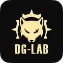

<div align="center">



# DG-LAB WebSocket Server

English | [简体中文](README_CN.md)

</div>

DG-LAB WebSocket Server is the server implementation for [DGLAB KIT](https://github.com/dungeonlab-open/dglab-kit/). Built with Bun, it provides a WebSocket relay between the DG-LAB app and third-party controllers.

Use it for local development or as a relay between your service and the DG-LAB app.

The project includes two protocol servers:

| Server | Default port | Description |
| --- | --- | --- |
| `v4-server.ts` | `9998` | WebSocket relay for the DG-LAB 4 app; supports one controller and multiple app clients |
| `v3-server.ts` | `9999` | Legacy WebSocket pairing server; supports one controller and one app client |

## Quick start

### Start the V4 server

```bash
bun run v4
```

The server listens on the following address by default:

```text
ws://127.0.0.1:9998
```

Connect with `dglab-kit`:

```ts
import { DglabSocket } from 'dglab-kit';

const socket = new DglabSocket({ url: 'ws://127.0.0.1:9998' });
const { targetId } = await socket.connect();

console.log('Pairing ID for app clients:', targetId);
```

An app client can connect to a specific controller by including its ID in the `tid` query parameter:

```text
ws://127.0.0.1:9998?tid=<controller-client-id>
```

You can also generate a Socket Control QR code for the DG-LAB 4 app:

```ts
const qrcode = `https://dungeon-lab.cn/s/?v=1&action=socket&url=${encodeURIComponent('ws://127.0.0.1:9998?tid=' + targetId)}`;
```

### Start the V3 server

```bash
bun run v3
```

The server listens on the following address by default:

```text
ws://127.0.0.1:9999
```

Connect with `dglab-kit`:

```ts
import {
  DGLAB_SOCKET_VERSION,
  DglabSocket,
  V3Channel,
} from 'dglab-kit';

const socket = new DglabSocket({
  version: DGLAB_SOCKET_VERSION.V3,
  url: 'ws://127.0.0.1:9999',
});

const { targetId } = await socket.connect();
console.log('Share this controller ID with the app client:', targetId);

socket.on('client-attached', () => {
  socket.setStrength(V3Channel.A, 20);
});
```

### Development mode

```bash
bun run dev:v4
bun run dev:v3
```

## Environment variables

Copy `.env.example` to `.env` and adjust the values as needed.

| Variable | Default | Description |
| --- | --- | --- |
| `PORT` | V4: `9998` / V3: `9999` | Port the server listens on |
| `HEARTBEAT_INTERVAL` | V4: `30000` / V3: `60000` | Interval between heartbeats, in milliseconds |
| `IDLE_TIMEOUT` | `300000` | Idle timeout, in milliseconds, for unpaired V3 connections or V4 controllers with no connected app clients |
| `PREFIX` | `/` | Global V4 WebSocket path prefix, such as `/v4` or `/relay/v4` |
| `DEFAULT_PUNISHMENT_TIME` | `1` | Number of V3 Pulse messages sent per second |
| `DEFAULT_PUNISHMENT_DURATION` | `5` | Default duration of V3 Pulse messages, in seconds |
| `LOG_LEVEL` | `info` | Log level: `debug`, `info`, `warn`, or `error` |
| `VERBOSE` | `false` | Set to `true` to force debug logging |

## V4 protocol

V4 is the recommended protocol. A controller connects to the server first and receives a `clientId`. App clients then connect using `tid=<controller-client-id>`. The controller sends WebSocket messages to individual app clients.

```text
Third-party controller <-> WebSocket Server <-> Multiple DG-LAB app clients
```

### V4 message flow

The V4 server distinguishes between controllers and app clients:

```text
1. The controller connects to ws://host:9998.
2. The server returns a hello frame containing the controller's clientId.
3. An app client connects to ws://host:9998?tid=<controller-client-id>.
4. The server sends client_attached to the controller.
5. The controller sends a message to a specific app client over WebSocket.
6. The app client processes the message and can send data back using message.
```

The V4 `data` field carries application payloads without modification. The server handles only the outer `type`, `clientId`, and `data` fields; it does not parse DG-LAB device commands. Use `dglab-kit` to generate device control commands.

### V4 QR codes

Generate a V4 Socket Control QR code for the DG-LAB 4 app using the controller's `targetId`:

```ts
const wsUrl = `wss://your-domain.example/v4?tid=${targetId}`;
const qrcode = `https://dungeon-lab.cn/s/?v=1&action=socket&url=${encodeURIComponent(wsUrl)}`;
```

For local development, use `ws://127.0.0.1:9998?tid=...`. If you set `PREFIX=/v4`, use `ws://127.0.0.1:9998/v4?tid=...`. Public deployments and connections from HTTPS pages generally require `wss://`.

### Controller connections

A connection to the V4 server without a `tid` parameter is treated as a controller:

```text
ws://127.0.0.1:9998
```

Once connected, the controller receives:

```json
{
  "type": "hello",
  "clientId": "<controller-client-id>"
}
```

App clients use this `clientId` to connect to the controller.

### App client connections

App clients specify the controller using `tid`:

```text
ws://127.0.0.1:9998?tid=<controller-client-id>
```

An app client also receives a `hello` frame when its connection is established. Once attached to the controller, it receives:

```json
{
  "type": "controller_attached",
  "clientId": "<controller-client-id>"
}
```

The controller receives:

```json
{
  "type": "client_attached",
  "clientId": "<app-client-id>"
}
```

If the controller disconnects, the app client receives `controller_disconnected` and its connection is closed. If an app client disconnects, the controller receives:

```json
{
  "type": "client_disconnected",
  "clientId": "<app-client-id>"
}
```

### WebSocket messages

To send a message from a controller to a specific app client:

```json
{
  "type": "message",
  "clientId": "<app-client-id>",
  "data": {
    "op": "example",
    "value": 1
  }
}
```

The app client receives:

```json
{
  "type": "message",
  "data": {
    "op": "example",
    "value": 1
  }
}
```

To send data from an app client to its controller:

```json
{
  "type": "message",
  "data": {
    "op": "report",
    "value": 1
  }
}
```

The controller receives:

```json
{
  "type": "message",
  "clientId": "<app-client-id>",
  "data": {
    "op": "report",
    "value": 1
  }
}
```

### V4 error codes

| Error | Description |
| --- | --- |
| `bad_request` | Invalid message format |
| `client_not_found` | The app client does not exist or is offline |
| `controller_not_found` | The controller specified by the app client does not exist |

### V4 close codes

| Close code | Description |
| --- | --- |
| `4000` | The controller disconnected, so the app client's connection was closed |
| `4001` | The controller specified by the app client does not exist |
| `4002` | The controller reached the idle timeout with no connected app clients |

## V3 protocol

V3 is the legacy protocol. It pairs two WebSocket connections:

```text
Third-party controller <-> WebSocket Server <-> DG-LAB app client
```

### V3 message flow

The V3 server maintains a pairing between a controller and an app client:

```text
1. The controller and app client each connect to ws://host:9999.
2. The server sends each connection a bind frame containing its own clientId.
3. The controller sends bind to pair its clientId with the app client's clientId.
4. Once paired, the controller sends intensity commands, clear commands, Pulses, or custom messages.
5. The server forwards feedback-* and strength-* reports from the app client to the controller.
6. If either side disconnects, the server sends break to the other side and closes its connection.
```

All V3 application messages use these four fields:

| Field | Description |
| --- | --- |
| `type` | Message type; determines how the server handles the message |
| `clientId` | Controller ID |
| `targetId` | App client ID |
| `message` | Message content: a command, Pulse data, or a report from the app |

### Connecting

When a client connects to the V3 server, the server immediately returns the connection's `clientId`:

```json
{
  "type": "bind",
  "clientId": "<connection-id>",
  "targetId": "",
  "message": "targetId"
}
```

Subsequent messages must include:

| Field | Description |
| --- | --- |
| `clientId` | Sender ID |
| `targetId` | Target ID |
| `type` | Message type |
| `message` | Message content |

### Pairing

Once the controller has the app client's `clientId`, it sends a pairing message:

```json
{
  "type": "bind",
  "clientId": "<controller-client-id>",
  "targetId": "<app-client-id>",
  "message": "targetId"
}
```

On success, both sides receive:

```json
{
  "type": "bind",
  "clientId": "<controller-client-id>",
  "targetId": "<app-client-id>",
  "message": "200"
}
```

### Channel Intensity control

For `type` values `1`, `2`, and `3`, the server converts the request into an intensity message understood by the DG-LAB app:

| `type` | Description |
| --- | --- |
| `1` | Decrease Channel Intensity |
| `2` | Increase Channel Intensity |
| `3` | Set Channel Intensity to `strength` |

```json
{
  "type": 3,
  "clientId": "<controller-client-id>",
  "targetId": "<app-client-id>",
  "channel": "A",
  "strength": 20,
  "message": "strength"
}
```

Accepted channel values are `1` / `A` / `a` and `2` / `B` / `b`.

The server forwards the following messages to the app:

| Controller request | Message forwarded to the app | Description |
| --- | --- | --- |
| `type: 1` | `strength-<channel>+0+1` | Decrease Channel Intensity for the specified channel |
| `type: 2` | `strength-<channel>+1+1` | Increase Channel Intensity for the specified channel |
| `type: 3` | `strength-<channel>+2+<strength>` | Set Channel Intensity for the specified channel |

### Setting intensity and clearing Pulses

Use `type: 4` to set Channel Intensity for a specific channel:

```json
{
  "type": 4,
  "clientId": "<controller-client-id>",
  "targetId": "<app-client-id>",
  "channel": "A",
  "strength": 30,
  "message": "strength"
}
```

To clear Pulses on a channel:

```json
{
  "type": 4,
  "clientId": "<controller-client-id>",
  "targetId": "<app-client-id>",
  "channel": "A",
  "message": "clear"
}
```

The server converts `type: 4` requests based on the contents of `message`:

| Controller request | Message forwarded to the app | Description |
| --- | --- | --- |
| `message` contains `clear` | `clear-<channel>` | Clear Pulses on the specified channel |
| `message` does not contain `clear` | `strength-<channel>+2+<strength>` | Set Channel Intensity for the specified channel |

### Pulse messages

For `type: "clientMsg"`, the server splits Pulse frames into multiple `pulse-` packets according to the configuration and sends them to the app at regular intervals.

```json
{
  "type": "clientMsg",
  "clientId": "<controller-client-id>",
  "targetId": "<app-client-id>",
  "channel": "A",
  "time": 5,
  "message": "<pulse-data>"
}
```

When transmission is complete, the controller receives:

```json
{
  "type": "notify",
  "clientId": "<controller-client-id>",
  "targetId": "<app-client-id>",
  "message": "发送完毕"
}
```

The server returns the literal string `发送完毕` ("Transmission complete") in this notification.

If a Pulse is already being sent on the same channel for the same controller, a new Pulse replaces it. The server sends a clear command to the app before starting the new Pulse.

The standard Pulse format is `A:[...]` or `B:[...]`. Each 16-character hexadecimal frame in the array represents `100 ms`. The server repeats or truncates the input frames to match the total duration specified by `time`, then splits them into packets according to the environment variables:

```text
Total frames = time * 10
Packets sent = DEFAULT_PUNISHMENT_TIME * time
Send interval = 1000 / DEFAULT_PUNISHMENT_TIME ms
Frames per packet ≈ 10 / DEFAULT_PUNISHMENT_TIME
```

If `DEFAULT_PUNISHMENT_TIME` exceeds `10`, the server caps the effective send rate at 10 packets per second to maintain a minimum of `100 ms` per frame. Legacy custom strings that cannot be parsed as standard Pulse arrays are still forwarded unchanged and sent repeatedly.

In application code, use `dglab-kit`'s `sendPulse` with built-in Pulse data and let the SDK handle serialization. This avoids manually encoding hexadecimal frames that the app may be unable to parse.

### V3 app reports

When an app client's `message` starts with `feedback` or `strength`, the server forwards it directly to the controller:

```json
{
  "type": "msg",
  "clientId": "<controller-client-id>",
  "targetId": "<app-client-id>",
  "message": "feedback-1"
}
```

```json
{
  "type": "msg",
  "clientId": "<controller-client-id>",
  "targetId": "<app-client-id>",
  "message": "strength-1+2+20"
}
```

Controllers can use these reports to update the UI, including button feedback, Channel Intensity, and status indicators.

### V3 QR codes

Generate a V3 Socket Control QR code for the DG-LAB 4 app using the controller's `targetId`:

```ts
const wsUrl = `wss://your-domain.example/${targetId}`;
const qrcode = `https://www.dungeon-lab.com/app-download.php#DGLAB-SOCKET#${encodeURIComponent(wsUrl)}`;
```

For local development, use `ws://127.0.0.1:9999/...`. Public deployments and connections from HTTPS pages generally require `wss://`.

### Heartbeats

The server periodically sends the following message to all connected clients:

```json
{
  "type": "heartbeat",
  "clientId": "<connection-id>",
  "targetId": "<paired-target-id>",
  "message": "200"
}
```

The server ignores incoming messages with `type: "heartbeat"` and does not forward them.

### V3 error codes

| Error code | Description |
| --- | --- |
| `400` | The connection is already paired |
| `401` | Invalid pairing target, or an attempt to pair a connection with itself |
| `402` | The two connections are not paired |
| `403` | Invalid message format |
| `404` | The target does not exist, or the message source is invalid |
| `406` | Invalid channel parameter |

When a connection closes, the server notifies its paired peer:

```json
{
  "type": "break",
  "clientId": "<paired-peer-client-id>",
  "targetId": "<disconnected-client-id>",
  "message": "209"
}
```

## Project structure

```text
dglab-websocket-server/
├── README.md
├── README_CN.md
├── .env.example
├── package.json
├── tsconfig.json
├── v3-server.ts
└── v4-server.ts
```
